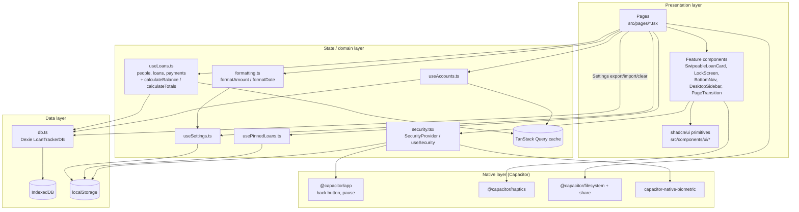
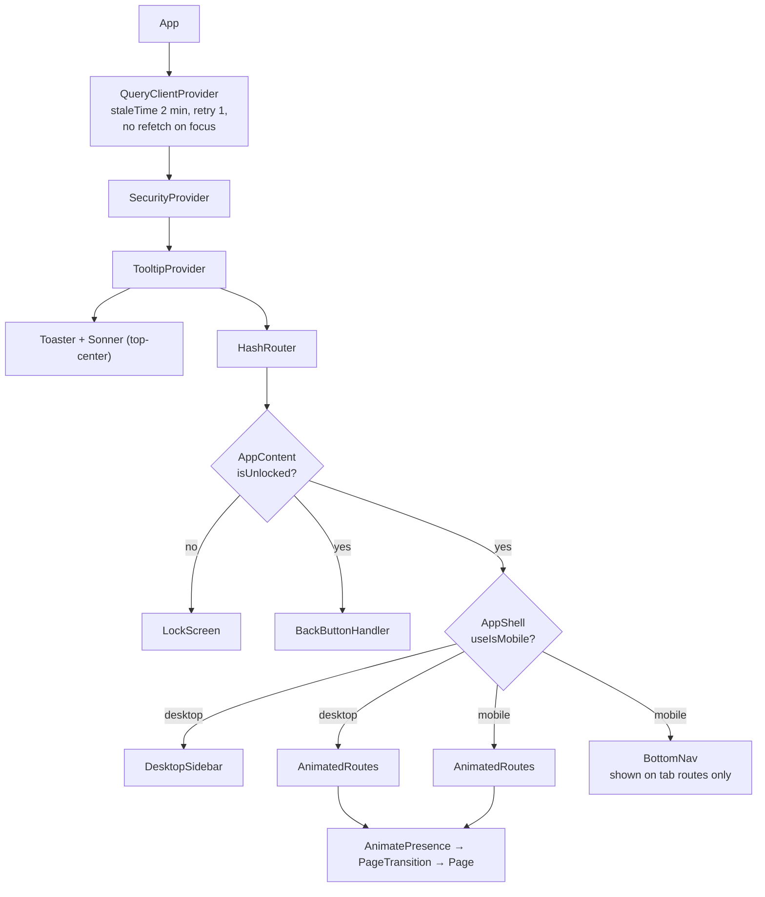
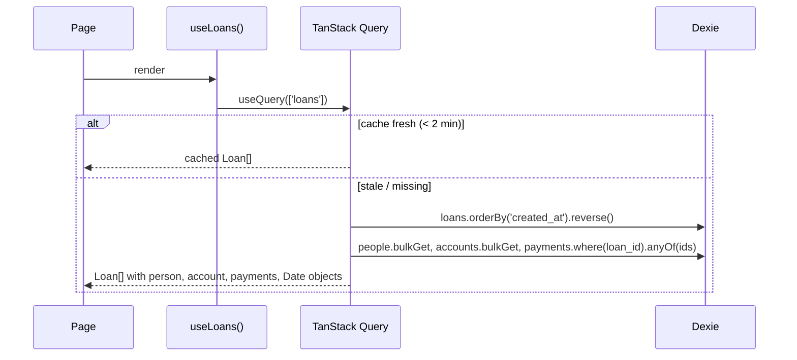
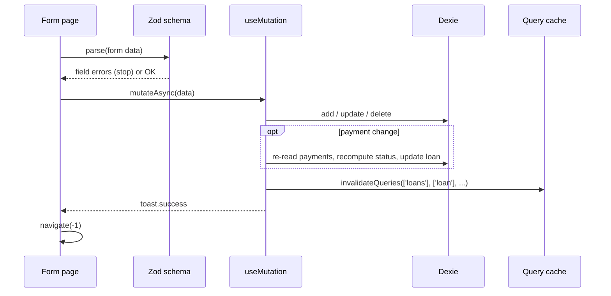
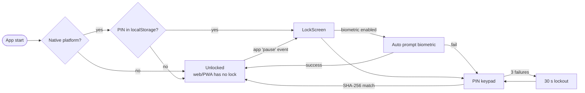

# LoanTracker — Code Architecture

## 1. Summary

LoanTracker is a **client-only** React single-page app. It has no backend. All data lives on the device in IndexedDB. The same web build runs in three places:

1. **Android app** — wrapped by Capacitor 8 (`com.nihap.loantracker`, minSdk 24, targetSdk 36).
2. **PWA** — installable, offline-cached by a Workbox service worker.
3. **Desktop browser** — wider layout with a sidebar.

## 2. Technology stack

| Layer | Technology | Where |
|---|---|---|
| UI framework | React 18, TypeScript 5 | `src/` |
| Build | Vite 5 + `@vitejs/plugin-react-swc` | [vite.config.ts](../vite.config.ts) |
| Styling | Tailwind CSS 3, `tailwindcss-animate`, Inter variable font | [tailwind.config.ts](../tailwind.config.ts), [src/index.css](../src/index.css) |
| Component library | shadcn/ui (Radix primitives) | [src/components/ui/](../src/components/ui/) |
| Routing | React Router 6, `HashRouter` | [src/App.tsx](../src/App.tsx) |
| Server-state / cache | TanStack Query 5 (used over the local DB) | [src/hooks/](../src/hooks/) |
| Persistence | Dexie 4 over IndexedDB | [src/lib/db.ts](../src/lib/db.ts) |
| Validation | Zod 3 | form pages |
| Animation | Framer Motion 12, `canvas-confetti` | `PageTransition`, `BottomNav`, pages |
| Gestures | `react-swipeable` | [SwipeableLoanCard.tsx](../src/components/SwipeableLoanCard.tsx) |
| Dates / numbers | `date-fns`, `Intl.NumberFormat` | [src/lib/formatting.ts](../src/lib/formatting.ts) |
| Toasts | `sonner` | hooks + pages |
| Native bridge | Capacitor: App, Haptics, Filesystem, Share, SplashScreen; `capacitor-native-biometric` | [capacitor.config.ts](../capacitor.config.ts) |
| PWA | `vite-plugin-pwa` (autoUpdate) + [public/manifest.json](../public/manifest.json) | |
| Tests | Vitest + Testing Library + jsdom | [src/test/](../src/test/) |

## 3. Layered view



**Rule of thumb:** pages never talk to IndexedDB directly, except [Settings.tsx](../src/pages/Settings.tsx) for bulk export, import and clear.

## 4. Folder structure

```
LoanTracker/
├─ src/
│  ├─ main.tsx                 Entry: mounts <App/>, hides splash after 1.4 s
│  ├─ App.tsx                  Providers, router, security gate, layout shell, routes
│  ├─ index.css / App.css      Tailwind layers + design tokens (CSS variables)
│  ├─ pages/                   One file per route (see §6)
│  ├─ components/
│  │  ├─ SwipeableLoanCard.tsx Swipe actions, long-press pin, haptics
│  │  ├─ LockScreen.tsx        PIN keypad, biometric prompt, lockout timer
│  │  ├─ PageTransition.tsx    Framer Motion route transition wrapper
│  │  ├─ NavLink.tsx
│  │  ├─ layout/               BottomNav (mobile), DesktopSidebar, MobileLayout
│  │  └─ ui/                   shadcn/ui primitives + LoanTrackerLogo, amount-display
│  ├─ hooks/
│  │  ├─ useLoans.ts           Person, Loan, Payment queries + mutations + calculations
│  │  ├─ useAccounts.ts        Account queries + mutations, ACCOUNT_ICONS
│  │  ├─ useSettings.ts        AppSettings in localStorage, getSettings()
│  │  ├─ usePinnedLoans.ts     Pinned loan IDs in localStorage
│  │  └─ use-mobile.tsx        Breakpoint hook
│  ├─ lib/
│  │  ├─ db.ts                 Dexie schema, generateId(), nowISO()
│  │  ├─ security.tsx          PIN/biometric context
│  │  ├─ formatting.ts         Currency + date formatting
│  │  └─ utils.ts              cn() class merge
│  └─ test/                    Vitest setup + example test
├─ android/                    Capacitor Android project (Gradle)
├─ public/                     manifest.json, icons, favicon
├─ docs/                       This documentation + privacy.html
├─ capacitor.config.ts
├─ vite.config.ts / vitest.config.ts / tailwind.config.ts
```

## 5. Component tree



## 6. Routes

`HashRouter` is used so routes work from `file://` inside the Capacitor WebView.

| Path | Page | Purpose | Bottom nav |
|---|---|---|---|
| `/` | `Index` → `Dashboard` | Totals, pinned loans, Receive/Pay tabs | Yes |
| `/people` | `People` | Searchable people list with balances | Yes |
| `/person/:id` | `PersonDetail` | One person's loans, edit/delete | No |
| `/add-person` | `AddPerson` | Create person | No |
| `/edit-person/:id` | `AddPerson` | Edit person | No |
| `/add-loan` | `AddLoan` | Create loan (`?person=<id>` preselects) | No |
| `/edit-loan/:id` | `AddLoan` | Edit amount, due date, notes | No |
| `/loan/:id` | `LoanDetail` | Loan info, payment history | No |
| `/add-payment/:loanId` | `AddPayment` | Record a payment | No |
| `/accounts` | `Accounts` | Accounts with outstanding GIVEN totals | Yes |
| `/account/:id` | `AccountDetail` | Open GIVEN loans for an account | No |
| `/add-account` | `AddAccount` | Create account | No |
| `/edit-account/:id` | `AddAccount` | Edit account | No |
| `/settings` | `Settings` | Display, data, security, danger zone | Yes |
| `*` | `NotFound` | 404 | No |

`TAB_ROUTES = ['/', '/people', '/accounts', '/settings']` controls when the bottom nav slides in.

## 7. Data flow

### 7.1 Read path



`enrichLoans` does one bulk read per table (people, accounts, payments), joins in memory and converts ISO strings to `Date` objects.

### 7.2 Write path



### 7.3 Query keys

| Key | Invalidated by |
|---|---|
| `['people']` | create/update/delete person |
| `['person', id]` | update person |
| `['loans']` (prefix, also matches `['loans','person',id]`) | any loan/payment mutation, delete person/account |
| `['loan', id]` | update loan; payment mutations invalidate `['loan']` prefix |
| `['accounts']`, `['account', id]` | account mutations |

### 7.4 Non-query state

`useSettings` and `usePinnedLoans` use the same small pattern: read/write JSON in `localStorage`, then dispatch a custom `window` event (`lt_settings_changed`, `lt_pinned_changed`) so every mounted hook instance reloads. `getSettings()` is a non-reactive snapshot used by `formatAmount` / `formatDate`.

## 8. Security architecture



- PIN: exactly 4 digits, stored as unsalted SHA-256 hex in `localStorage`. The lockout end time is persisted too.
- Biometric can be enabled only after a PIN exists; enabling runs a test prompt.
- Removing the PIN also disables biometric.
- The security section in Settings is shown only on native platforms.

## 9. Native integration

| Feature | API | Behaviour |
|---|---|---|
| Splash | `SplashScreen.hide` | Auto-hide off; hidden 1400 ms after mount with 200 ms fade |
| Back button | `App.addListener('backButton')` | On `/` or no history: exit app; else `navigate(-1)` |
| Auto-lock | `App.addListener('pause')` | Locks when app goes to background (if PIN set) |
| Haptics | `Haptics.impact/notification` | Swipe open, actions, pin, keypad, success/error. Respects `hapticFeedback` setting in the card |
| Backup export | `Filesystem.writeFile(Cache)` + `Share.share` | No storage permission needed; browser falls back to a Blob download |
| Biometric | `NativeBiometric.isAvailable / verifyIdentity` | Fingerprint, face, iris |

## 10. Build and release

| Task | Command |
|---|---|
| Dev server (port 8080) | `npm run dev` |
| Production web build → `dist/` | `npm run build` |
| Lint | `npm run lint` |
| Tests | `npm test` |
| Copy web build into Android | `npx cap sync android` |
| Open Android Studio | `npx cap open android` |

Release signing credentials are read from `android/local.properties` (not committed). Current Android version: `versionCode 2`, `versionName "1.0"`.

## 11. Design decisions

| Decision | Reason |
|---|---|
| Offline-only, IndexedDB | Privacy; no accounts; works without network. Replaced the earlier Firebase/Supabase version (branch `Offline`) |
| TanStack Query over a local DB | Uniform loading/error states, caching and invalidation, easy to swap back to a remote API |
| Status stored, not only derived | Fast filtering by indexed `status` |
| `HashRouter` | Reliable inside Capacitor WebView and static hosting |
| Dates stored as ISO strings | IndexedDB-friendly, JSON backup-friendly; converted to `Date` in hooks |
| Single-file pages with inline sub-components | Small app; avoids premature abstraction |
