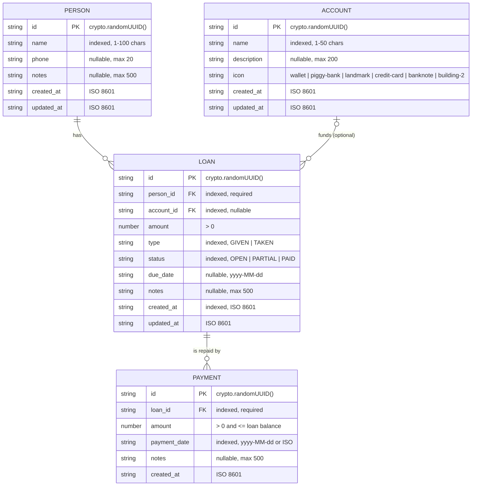
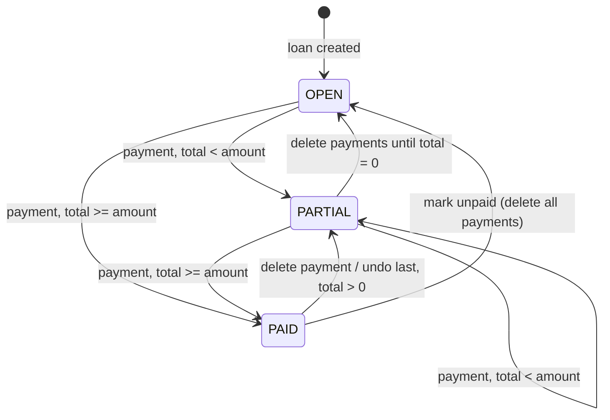

# LoanTracker — Entity Relationship Diagram

LoanTracker stores all business data on the device in **IndexedDB** through [Dexie](https://dexie.org/). The database is named `LoanTrackerDB` and is defined in [src/lib/db.ts](../src/lib/db.ts) (schema version `1`). Small preference values live in `localStorage`.

There is no server database.

## 1. Diagram



## 2. Tables

### 2.1 `people`
Dexie index string: `'id, name'`

| Field | Type | Null | Rule | Notes |
|---|---|---|---|---|
| `id` | string (UUID v4) | No | Primary key | `generateId()` |
| `name` | string | No | Trimmed, 1–100 chars | Indexed; lists sort by it |
| `phone` | string | Yes | Max 20 chars | Free text, no format check |
| `notes` | string | Yes | Max 500 chars | |
| `created_at` | ISO string | No | | Set on create |
| `updated_at` | ISO string | No | | Set on create and update |

### 2.2 `accounts`
Dexie index string: `'id, name'`

| Field | Type | Null | Rule | Notes |
|---|---|---|---|---|
| `id` | string (UUID v4) | No | Primary key | |
| `name` | string | No | Trimmed, 1–50 chars | Indexed |
| `description` | string | Yes | Max 200 chars | |
| `icon` | string | No | One of `ACCOUNT_ICONS` | Default `wallet` |
| `created_at` | ISO string | No | | |
| `updated_at` | ISO string | No | | |

### 2.3 `loans`
Dexie index string: `'id, person_id, account_id, status, type, created_at'`

| Field | Type | Null | Rule | Notes |
|---|---|---|---|---|
| `id` | string (UUID v4) | No | Primary key | |
| `person_id` | string | No | Must reference a `people.id` | Not editable after create |
| `account_id` | string | Yes | References `accounts.id` | Editable |
| `amount` | number | No | > 0 | Principal. No interest model |
| `type` | enum | No | `GIVEN` \| `TAKEN` | `GIVEN` = user lent money; `TAKEN` = user borrowed. Not editable after create |
| `status` | enum | No | `OPEN` \| `PARTIAL` \| `PAID` | Derived from payments, see §3 |
| `due_date` | date string | Yes | | From `<input type="date">` |
| `notes` | string | Yes | Max 500 chars | |
| `created_at` | ISO string | No | | Indexed; dashboard sorts newest first |
| `updated_at` | ISO string | No | | |

### 2.4 `payments`
Dexie index string: `'id, loan_id, payment_date'`

| Field | Type | Null | Rule | Notes |
|---|---|---|---|---|
| `id` | string (UUID v4) | No | Primary key | |
| `loan_id` | string | No | References `loans.id` | |
| `amount` | number | No | > 0 and ≤ remaining balance | Checked in the Add Payment form only |
| `payment_date` | date string | No | Required | Form sends `yyyy-MM-dd`; falls back to full ISO timestamp |
| `notes` | string | Yes | Max 500 chars | Quick "Mark paid" writes `"Marked as paid"` |
| `created_at` | ISO string | No | | Used to find the "last" payment for undo |

## 3. Derived values

These values are never stored. They are computed in [src/hooks/useLoans.ts](../src/hooks/useLoans.ts).

| Value | Formula |
|---|---|
| Total paid | `Σ payments.amount` where `payment.loan_id = loan.id` |
| Balance | `loan.amount − total paid` |
| Progress % | `total paid / loan.amount × 100` |
| Status | `PAID` if total paid ≥ amount; `PARTIAL` if total paid > 0; else `OPEN` |
| To Receive | `Σ balance` of non-PAID `GIVEN` loans with amount > 0 |
| To Pay | `Σ balance` of non-PAID `TAKEN` loans with amount > 0 |
| Account outstanding | `Σ balance` of non-PAID `GIVEN` loans with that `account_id` |

Status is recalculated after every payment create or delete and after a loan amount edit.

### Loan status state machine



## 4. Referential integrity

IndexedDB has no foreign key constraints. Integrity is handled in application code, and only partly:

| Action | What happens to children |
|---|---|
| Delete loan | All its payments are deleted (cascade in `useDeleteLoan`) |
| Delete person | Their loans and those loans' payments are deleted (one transaction) |
| Delete account | `account_id` set to `null` on its loans (one transaction) |
| Clear all data | All four tables cleared in one transaction |
| Import backup | All four tables cleared, then bulk-added, in one transaction |

## 5. localStorage keys

| Key | Owner | Shape |
|---|---|---|
| `lt_settings` | [useSettings.ts](../src/hooks/useSettings.ts) | JSON `AppSettings` (currency symbol, position, number locale, date format, haptics) |
| `lt_pinned_loans` | [usePinnedLoans.ts](../src/hooks/usePinnedLoans.ts) | JSON array of loan IDs, newest pin first |
| `app_security_pin` | [security.tsx](../src/lib/security.tsx) | SHA-256 hex of the 4-digit PIN |
| `app_biometric_enabled` | [security.tsx](../src/lib/security.tsx) | `"true"` \| `"false"` |
| `app_lockout_until` | [LockScreen.tsx](../src/components/LockScreen.tsx) | Epoch ms when PIN lockout ends |

## 6. Backup file format

Export writes `loantracker-backup-YYYY-MM-DD.json`:

```json
{
  "exportedAt": "2026-10-04T10:00:00.000Z",
  "version": 1,
  "people":   [ /* Person rows */ ],
  "accounts": [ /* Account rows */ ],
  "loans":    [ /* Loan rows */ ],
  "payments": [ /* Payment rows */ ]
}
```

Import validates every row with Zod (`people`, `loans`, `payments` required; `accounts` optional). Any `user_id` field (from the old cloud version) is stripped. Import **replaces** all existing data.
