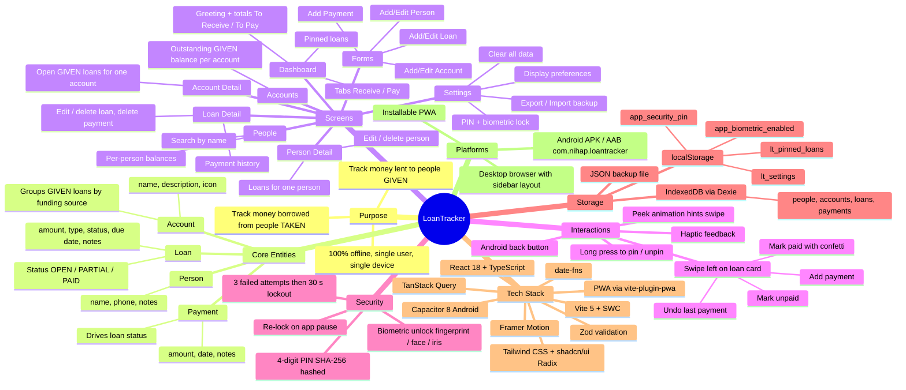

# LoanTracker — System Mind Map

A one-page overview of everything the system is and does. Diagrams use [Mermaid](https://mermaid.js.org/) and render on GitHub and in VS Code (with a Mermaid preview extension).

## Reading guide

| Branch | Detail document |
|---|---|
| Core Entities, Storage | [ERD.md](ERD.md) |
| Screens, Tech Stack, Platforms | [ARCHITECTURE.md](ARCHITECTURE.md) |
| Interactions, Security | [USE_CASES.md](USE_CASES.md) |
| Everything, with requirements | [SRS.md](SRS.md) |
