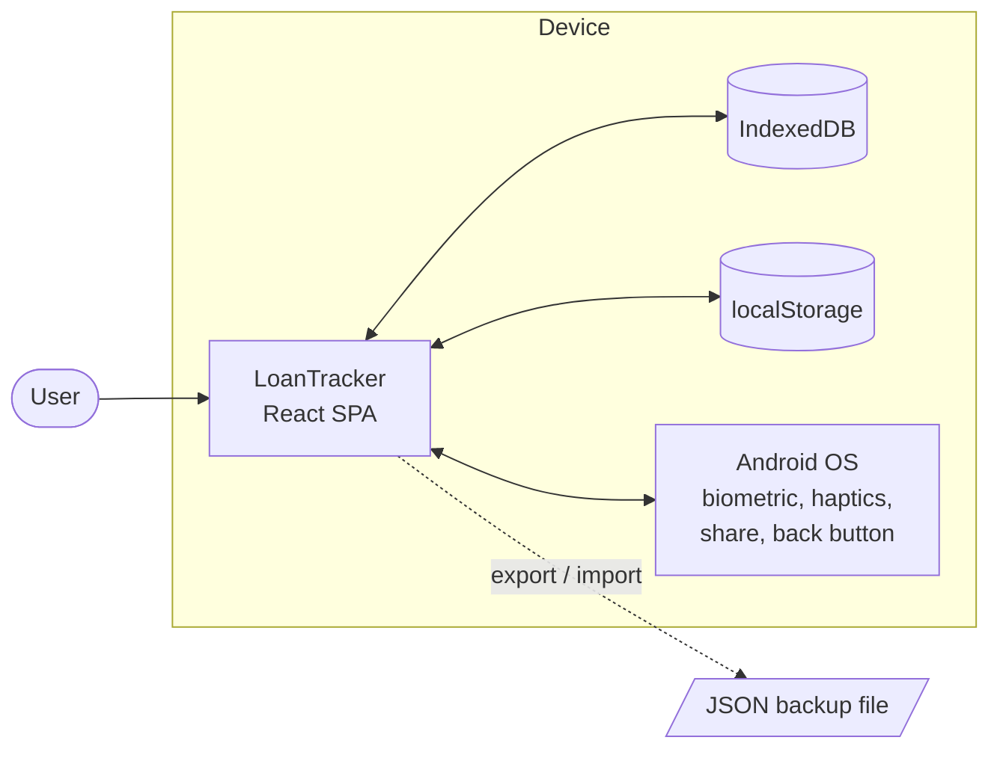
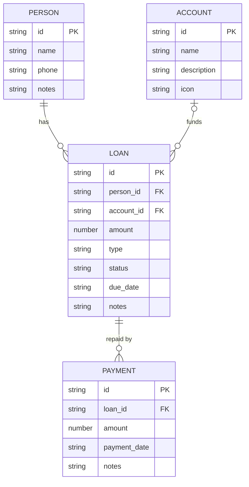
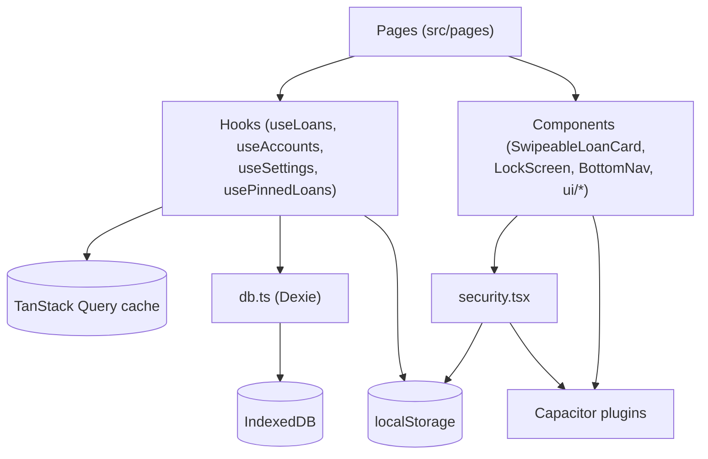

# Software Requirements Specification — LoanTracker

| Item | Value |
|---|---|
| Product | LoanTracker |
| Version of product | 1.0 (Android `versionCode 2`) |
| Document version | 1.0 |
| Date | 2026-10-04 |
| Author | Nihap (nihapmrm@gmail.com) |
| Status | Describes the system as built on branch `Offline` |

Companion documents: [MINDMAP.md](MINDMAP.md) · [ERD.md](ERD.md) · [ARCHITECTURE.md](ARCHITECTURE.md) · [USE_CASES.md](USE_CASES.md)

---

## Table of contents

1. Introduction
2. Overall description
3. System features and functional requirements
4. Data requirements
5. External interface requirements
6. Non-functional requirements
7. System architecture
8. Validation rules
9. Known issues and risks
10. Future enhancements
11. Appendices

---

## 1. Introduction

### 1.1 Purpose
This document specifies the requirements of LoanTracker, a personal app for recording money lent to and borrowed from other people. It is written for developers maintaining the app, testers, and reviewers (for example app store reviewers). It describes the system as it is currently implemented, and lists known gaps.

### 1.2 Scope
LoanTracker lets one person, on one device:

- Keep a list of **people** they lend to or borrow from.
- Record **loans** in two directions: **GIVEN** (the user lent money) and **TAKEN** (the user borrowed money).
- Record **payments** against loans, with automatic status (OPEN, PARTIAL, PAID).
- Group lent money by **accounts** (for example "Cash", "Bank").
- See totals: how much they will receive and how much they must pay.
- Back up and restore all data as a JSON file.
- Protect the app with a PIN and biometrics on Android.

The app is **fully offline**. It has no server, no user accounts, no sync and no analytics. It is distributed as an Android app (Capacitor) and as an installable PWA.

Out of scope: interest calculation, multi-currency per loan, reminders/notifications, multi-device sync, multi-user sharing.

### 1.3 Definitions

| Term | Meaning |
|---|---|
| Person | A counterparty: someone the user lends to or borrows from. |
| Loan | One amount of money between the user and a person, in one direction. |
| GIVEN | Loan type: the user gave money; the user will **receive** it back. |
| TAKEN | Loan type: the user took money; the user must **pay** it back. |
| Payment | A partial or full repayment of a loan. |
| Balance | Loan amount minus the sum of its payments. |
| Account | A user-defined label for where lent money came from (wallet, bank, etc.). |
| Pinned loan | A loan the user marked to always show at the top of the dashboard. |
| Native | Running inside the Capacitor Android app (as opposed to a browser). |
| PWA | Progressive Web App — the web build installed to a home screen. |
| Dexie | JavaScript wrapper around the browser's IndexedDB database. |

### 1.4 References
- Source code: this repository, branch `Offline`.
- Privacy policy: [docs/privacy.html](privacy.html).
- Capacitor 8, Dexie 4, TanStack Query 5, React Router 6, Zod 3 documentation.

### 1.5 Document overview
Section 2 describes the product in general. Section 3 lists functional requirements by feature. Sections 4–6 cover data, interfaces and quality attributes. Section 7 summarises the architecture. Section 9 lists defects and risks found while writing this document.

---

## 2. Overall description

### 2.1 Product perspective
LoanTracker is a standalone, self-contained product. It started as a Lovable-generated web app with a cloud backend (Firebase, later Supabase) and was rebuilt to be offline-first with local IndexedDB storage. Some files from the cloud version remain but are not used (see §9).



### 2.2 Product functions (summary)
- Dashboard with totals, pinned loans, and Receive/Pay lists.
- People: add, edit, delete, search, see per-person balances.
- Loans: add, edit (amount, due date, notes), delete, view details.
- Payments: add, delete, quick "mark paid", "mark unpaid", "undo last".
- Accounts: add, edit, delete, see outstanding lent amount per account.
- Settings: currency, number format, date format, haptics, export, import, clear data, PIN, biometric.

See [MINDMAP.md](MINDMAP.md) for the full feature map.

### 2.3 User classes
| Class | Description | Technical skill |
|---|---|---|
| Owner | The only user. Individual who lends/borrows small sums with friends, family or customers. | Basic smartphone use |

### 2.4 Operating environment
| Platform | Requirement |
|---|---|
| Android | Android 7.0 (API 24) or later; target API 36. Biometric hardware optional. |
| Browser / PWA | Modern evergreen browser with IndexedDB, `crypto.randomUUID`, `crypto.subtle` (secure context: HTTPS or localhost). |
| Screen | Mobile-first (portrait). Desktop layout with sidebar when the viewport is wide. |
| Network | Not required after install. |

### 2.5 Design and implementation constraints
- C-1: No backend; all data must stay on the device.
- C-2: Web code must run unchanged inside the Capacitor WebView; therefore `HashRouter` is used.
- C-3: UI built with React 18, TypeScript, Tailwind and shadcn/ui.
- C-4: IndexedDB has no foreign keys; integrity rules live in application code.
- C-5: PIN and biometric features are available only on native platforms.

### 2.6 Assumptions and dependencies
- A-1: One user per device; there is no login.
- A-2: The user handles off-device backups by exporting files.
- A-3: Clearing app storage or uninstalling deletes all data permanently.
- A-4: All amounts share one display currency; the app does no currency conversion.

---

## 3. System features and functional requirements

Requirement IDs use the form `FR-<area>-<n>`. Priority: **H** = must, **M** = should, **L** = nice to have. Related use cases are in [USE_CASES.md](USE_CASES.md).

### 3.1 Dashboard (UC-01)
| ID | Requirement | Pri |
|---|---|---|
| FR-DSH-1 | The system shall show a greeting that depends on the time of day. | L |
| FR-DSH-2 | The system shall show **To Receive** = sum of balances of loans with type GIVEN, status ≠ PAID and amount > 0. | H |
| FR-DSH-3 | The system shall show **To Pay** = sum of balances of loans with type TAKEN, status ≠ PAID and amount > 0. | H |
| FR-DSH-4 | The system shall show pinned, unpaid loans in a separate section above the tabs. | M |
| FR-DSH-5 | The system shall show unpaid, unpinned loans in two tabs, **Receive** (GIVEN) and **Pay** (TAKEN), newest first. | H |
| FR-DSH-6 | Each loan card shall show the person, balance, and a progress bar (paid / amount). | H |
| FR-DSH-7 | Tapping a loan card shall open Loan Detail. | H |
| FR-DSH-8 | The system shall show an empty state when there are no loans. | M |

### 3.2 People (UC-02, UC-03, UC-04)
| ID | Requirement | Pri |
|---|---|---|
| FR-PPL-1 | The user shall be able to create a person with a name (required), phone and notes. | H |
| FR-PPL-2 | The user shall be able to edit a person's name, phone and notes. | H |
| FR-PPL-3 | The user shall be able to delete a person after confirmation; the person's loans and payments are deleted too. | M |
| FR-PPL-4 | The People list shall be sorted by name and show, per person, the open amount to receive and to pay. | H |
| FR-PPL-5 | The People list shall filter by a case-insensitive name substring as the user types. | M |
| FR-PPL-6 | Person Detail shall list all loans of that person and their net balances. | H |
| FR-PPL-7 | Person Detail shall offer "add loan" with the person preselected (`/add-loan?person=<id>`). | M |

### 3.3 Loans (UC-05 … UC-08)
| ID | Requirement | Pri |
|---|---|---|
| FR-LN-1 | The user shall be able to create a loan with: type (GIVEN/TAKEN), person, amount, optional account, optional due date, optional notes. | H |
| FR-LN-2 | A new loan shall have status OPEN. | H |
| FR-LN-3 | The user shall be able to create a person or account from inside the loan form. | M |
| FR-LN-4 | The user shall be able to edit a loan's amount, account, due date and notes; status is recalculated. | M |
| FR-LN-5 | The user shall be able to delete a loan after confirmation; its payments shall also be deleted. | H |
| FR-LN-6 | Loan Detail shall show person, type, amount, total paid, balance, progress, due date, account, notes and payment history. | H |

### 3.4 Payments (UC-09 … UC-13)
| ID | Requirement | Pri |
|---|---|---|
| FR-PAY-1 | The user shall be able to record a payment with amount, date (default today) and notes. | H |
| FR-PAY-2 | A payment amount shall be > 0 and ≤ the loan's remaining balance. | H |
| FR-PAY-3 | After any payment is added or deleted, the system shall set loan status: PAID if total paid ≥ amount; PARTIAL if total paid > 0; else OPEN. | H |
| FR-PAY-4 | **Mark paid** shall create one payment for the full remaining balance, note "Marked as paid", and show a confetti animation. | H |
| FR-PAY-5 | **Mark unpaid** shall delete all payments of the loan and set status OPEN. | M |
| FR-PAY-6 | **Undo last** shall delete the most recently created payment and recalculate status. | M |
| FR-PAY-7 | The user shall be able to delete any single payment from Loan Detail. | M |

### 3.5 Loan card interactions (UC-10 … UC-14)
| ID | Requirement | Pri |
|---|---|---|
| FR-CARD-1 | Swiping a loan card left by more than 50 px shall reveal an action tray (add payment, mark paid / unpaid / undo, depending on status). | H |
| FR-CARD-2 | Swiping right by more than 40 px shall close the tray. | H |
| FR-CARD-3 | A long press of 600 ms shall toggle the pin state of the loan. | L |
| FR-CARD-4 | Cards shall play a short "peek" animation on mount to hint the swipe action. | L |
| FR-CARD-5 | Card actions shall give haptic feedback on native platforms when haptics are enabled. | L |
| FR-CARD-6 | Pinned loan IDs shall persist across app restarts. | M |

### 3.6 Accounts (UC-15, UC-16)
| ID | Requirement | Pri |
|---|---|---|
| FR-ACC-1 | The user shall be able to create an account with name, description and icon. | M |
| FR-ACC-2 | Available icons: wallet, piggy-bank, landmark, credit-card, banknote, building-2. Default: wallet. | L |
| FR-ACC-3 | The user shall be able to edit and delete accounts; deleting unlinks the account from its loans. | M |
| FR-ACC-4 | The Accounts list shall show, per account, the outstanding balance of its unpaid GIVEN loans. | M |
| FR-ACC-5 | Account Detail shall list unpaid GIVEN loans of that account sorted by balance, largest first, and their total. | M |

### 3.7 Settings — display (UC-17)
| ID | Requirement | Pri |
|---|---|---|
| FR-SET-1 | The user shall be able to choose a currency symbol: Rs. (default), ₹, $, €, £, ¥, kr, or custom text. | M |
| FR-SET-2 | The user shall be able to place the symbol before or after the amount. | L |
| FR-SET-3 | The user shall be able to choose a number locale: en-US, en-IN, de-DE, fr-FR. | L |
| FR-SET-4 | The user shall be able to choose a date format: `MMM d, yyyy`, `dd/MM/yyyy`, `MM/dd/yyyy`, `yyyy-MM-dd`. | L |
| FR-SET-5 | The user shall be able to turn haptic feedback on or off. | L |
| FR-SET-6 | Display changes shall apply immediately on all screens without restart. | M |
| FR-SET-7 | Amounts shall show 0–2 decimal places and use the absolute value. | M |

### 3.8 Settings — data (UC-18, UC-19, UC-20)
| ID | Requirement | Pri |
|---|---|---|
| FR-DATA-1 | Export shall produce a JSON file `loantracker-backup-YYYY-MM-DD.json` with `exportedAt`, `version: 1`, and all rows of people, accounts, loans and payments. | H |
| FR-DATA-2 | On Android, export shall open the system share sheet without needing storage permission. In a browser, export shall download the file. | H |
| FR-DATA-3 | Cancelling the share sheet shall not show an error. | L |
| FR-DATA-4 | Import shall accept a `.json` file whose rows pass schema validation (`people`, `loans`, `payments` arrays; `accounts` optional). | H |
| FR-DATA-5 | Import shall ask for confirmation, then replace all existing data inside a single transaction; on any error no data shall change. | H |
| FR-DATA-6 | Import shall remove any `user_id` field from rows. | M |
| FR-DATA-7 | Import shall report how many people, accounts, loans and payments were imported. | M |
| FR-DATA-8 | Clear All Data shall ask for confirmation and then delete all rows from all four tables. | M |

### 3.9 Security (UC-21 … UC-23)
| ID | Requirement | Pri |
|---|---|---|
| FR-SEC-1 | On native platforms the user shall be able to set a PIN of exactly 4 digits. | M |
| FR-SEC-2 | The PIN shall be stored only as a SHA-256 hash. | M |
| FR-SEC-3 | When a PIN is set, the app shall show the lock screen at start and whenever the app is paused (sent to background). | M |
| FR-SEC-4 | After 3 wrong PIN entries the lock screen shall block input for 30 seconds and show a countdown; the lockout shall survive an app restart. | M |
| FR-SEC-5 | The user shall be able to enable biometric unlock only after setting a PIN; enabling shall require a successful biometric test. | L |
| FR-SEC-6 | If biometric unlock is enabled, the lock screen shall open the biometric prompt automatically; PIN remains as fallback. | L |
| FR-SEC-7 | Removing the PIN shall also disable biometric unlock. | M |
| FR-SEC-8 | Security settings shall not be shown in a browser/PWA. | M |

### 3.10 Navigation and platform
| ID | Requirement | Pri |
|---|---|---|
| FR-NAV-1 | On mobile, a bottom navigation bar with Home, People, Add (+), Accounts, Settings shall show on tab routes (`/`, `/people`, `/accounts`, `/settings`) and hide elsewhere. | H |
| FR-NAV-2 | On wide screens, a left sidebar shall replace the bottom bar. | M |
| FR-NAV-3 | Route changes shall animate. | L |
| FR-NAV-4 | The Android back button shall go back in history, or exit the app on the home screen or when no history exists. | H |
| FR-NAV-5 | The splash screen shall hide about 1.4 s after launch. | L |
| FR-NAV-6 | Unknown routes shall show a 404 page. | L |
| FR-NAV-7 | Every successful or failed write shall show a toast message. | M |

---

## 4. Data requirements

Full details, diagram and integrity rules: [ERD.md](ERD.md).



| ID | Requirement |
|---|---|
| DR-1 | All business data shall be stored in IndexedDB database `LoanTrackerDB`, schema version 1, tables `people`, `accounts`, `loans`, `payments`. |
| DR-2 | Every row shall have a UUID v4 primary key from `crypto.randomUUID()`. |
| DR-3 | Timestamps (`created_at`, `updated_at`) shall be ISO 8601 strings. |
| DR-4 | Balance, totals and progress shall be computed, not stored. Status is stored and kept in sync on payment changes. |
| DR-5 | Settings, pinned loans, PIN hash and biometric flag shall be stored in `localStorage` (keys in ERD §5). |
| DR-6 | Data shall persist across app restarts and updates; it is lost if app storage is cleared or the app is uninstalled. |
| DR-7 | Schema changes shall add a new `this.version(n)` block in `db.ts` with an upgrade function; existing versions must not be edited. |

---

## 5. External interface requirements

### 5.1 User interface
- Mobile-first, portrait, one-hand use; primary action (+) centred in the bottom bar.
- Light/dark theme through CSS variables (Tailwind tokens in `index.css`).
- Inter variable font.
- Respect safe-area insets (notch, gesture bar).
- Forms show inline field errors under each input.
- Destructive actions (delete person/loan/payment/account, clear data) use a confirmation dialog.
- Positive feedback: toasts, haptics, confetti on "mark paid".

### 5.2 Hardware interfaces
| Interface | Use |
|---|---|
| Biometric sensor | Fingerprint, face or iris unlock via `capacitor-native-biometric` |
| Vibration motor | Haptic feedback via `@capacitor/haptics` |
| Touch screen | Swipe and long-press gestures |

### 5.3 Software interfaces
| Interface | Use |
|---|---|
| IndexedDB (via Dexie) | Persistent storage |
| localStorage | Preferences and security flags |
| Web Crypto API | `randomUUID`, SHA-256 PIN hash |
| Capacitor App | Back button, pause/resume, exit |
| Capacitor Filesystem + Share | Backup export on Android |
| Capacitor SplashScreen | Launch screen control |
| Service worker (Workbox) | Offline caching of the web build |

### 5.4 Communication interfaces
None. The app makes no network requests at runtime. (Google Fonts/CDN are not used; the font is bundled.)

---

## 6. Non-functional requirements

### 6.1 Performance
| ID | Requirement |
|---|---|
| NFR-P-1 | Screens shall render from local data in under 300 ms for up to 1,000 loans on a mid-range Android phone. |
| NFR-P-2 | Query results shall be cached for 2 minutes and refreshed after every write (TanStack Query invalidation). |
| NFR-P-3 | Swipe and page animations shall run at 60 fps on mid-range devices. |

### 6.2 Reliability and data integrity
| ID | Requirement |
|---|---|
| NFR-R-1 | Import and clear-all shall be atomic (single Dexie transaction). |
| NFR-R-2 | Deleting a loan shall also delete its payments. |
| NFR-R-3 | Loan status shall always match the sum of its payments after any payment change. |
| NFR-R-4 | The app shall work with no network connection, from first launch after install. |

### 6.3 Security and privacy
| ID | Requirement |
|---|---|
| NFR-S-1 | No personal or financial data shall leave the device except through a user-initiated export. |
| NFR-S-2 | The app shall contain no ads, analytics or tracking SDKs. |
| NFR-S-3 | The PIN shall never be stored in plain text. |
| NFR-S-4 | Biometric data shall be handled only by the OS; the app receives only success/failure. |
| NFR-S-5 | Release signing keys shall not be committed to the repository (read from `android/local.properties`). |

### 6.4 Usability
| ID | Requirement |
|---|---|
| NFR-U-1 | Core tasks (add loan, record payment, mark paid) shall need no more than 3 taps from the dashboard, plus data entry. |
| NFR-U-2 | All destructive actions shall need explicit confirmation, except swipe "mark unpaid" / "undo last". |
| NFR-U-3 | Text and controls shall remain usable at phone width (≥ 320 px). |

### 6.5 Maintainability
| ID | Requirement |
|---|---|
| NFR-M-1 | All data access shall go through hooks in `src/hooks/` (exception: bulk operations in Settings). |
| NFR-M-2 | Code shall pass `npm run lint` and TypeScript checks. |
| NFR-M-3 | Use path alias `@/` for imports from `src/`. |

### 6.6 Portability
| ID | Requirement |
|---|---|
| NFR-PO-1 | One code base shall build the Android app, the PWA and the desktop web view. |
| NFR-PO-2 | Native-only features shall be guarded by `Capacitor.isNativePlatform()` so the web build does not fail. |

---

## 7. System architecture

Full details: [ARCHITECTURE.md](ARCHITECTURE.md).



Key points:
- **Provider order:** `QueryClientProvider → SecurityProvider → TooltipProvider → HashRouter → AppContent`.
- **Security gate:** `AppContent` renders `LockScreen` instead of the app while `isUnlocked` is false.
- **Layout:** `AppShell` picks `DesktopSidebar` or `BottomNav` via `useIsMobile()`.
- **Routing:** 15 routes, all wrapped in `PageTransition` inside `AnimatePresence`.

---

## 8. Validation rules

Implemented with Zod in the form pages.

| Form | Field | Rule | Message |
|---|---|---|---|
| Person | name | trim, 1–100 chars | "Name is required" / "Name is too long" |
| Person | phone | trim, ≤ 20 chars, optional | "Phone number is too long" |
| Person | notes | trim, ≤ 500, optional | "Notes are too long" |
| Account | name | trim, 1–50 chars | "Name is required" / "Name is too long" |
| Account | description | trim, ≤ 200, optional | "Description is too long" |
| Loan | person_id | non-empty | "Please select a person" |
| Loan | amount | number > 0 | "Amount must be greater than 0" |
| Loan | type | GIVEN \| TAKEN | |
| Loan | notes | trim, ≤ 500, optional | "Notes are too long" |
| Payment | amount | > 0 and ≤ balance | "Amount cannot exceed remaining balance of …" |
| Payment | payment_date | non-empty | "Payment date is required" |
| Payment | notes | trim, ≤ 500, optional | "Notes are too long" |
| PIN | pin | exactly 4 digits `^\d{4}$` | "PIN must be exactly 4 digits" |

---

## 9. Known issues and risks

A review for the first version of this document found 16 issues. All were fixed in the same change set; the table records what was done. Remaining caveats follow the table.

| # | Severity | Issue | Resolution |
|---|---|---|---|
| K-1 | High | `.env` with Firebase keys committed to git. | Untracked with `git rm --cached`; `.env` and `.env.*` added to `.gitignore`. **Still to do by owner:** the keys remain in git history; rotate or delete the Firebase project keys. |
| K-2 | High | Import replaced all data without confirmation. | Picking a file now opens a "Replace all data?" dialog; import runs only after confirming. |
| K-3 | Medium | Deleting a person left orphan loans. | `useDeletePerson` deletes the person's loans and payments in one transaction (the dialog already said so). |
| K-4 | Medium | Deleting an account left dangling `account_id`. | `useDeleteAccount` sets `account_id = null` on its loans in one transaction. |
| K-5 | Medium | Editing loan amount did not recompute status. | `useUpdateLoan` calls `recalcStatus` when the amount changes. |
| K-6 | Medium | Edit form dropped changes. | Person and type are hidden in edit mode (immutable by design). Account is now saved. Due-date prefill fixed to `yyyy-MM-dd`. |
| K-7 | Medium | Privacy policy described the old cloud version. | `docs/privacy.html` rewritten for the offline app. |
| K-8 | Medium | Import accepted malformed rows. | Backup validated with a Zod schema; the first failing field is reported; nothing is written on failure. |
| K-9 | Medium | PIN lockout reset on app restart. | Lockout end time persisted in `localStorage` (`app_lockout_until`). The PIN is still an unsalted SHA-256 of 4 digits, so it is a casual lock, not strong protection. |
| K-10 | Low | Status logic copied four times. | Single `deriveStatus` + `recalcStatus` in `useLoans.ts`. |
| K-11 | Low | Mixed `payment_date` formats. | Default is now local `yyyy-MM-dd` via `todayISODate()` (also fixes a UTC off-by-one near midnight). |
| K-12 | Low | Duplicate type names. | Raw DB types renamed `PersonRow`, `AccountRow`, `LoanRow`, `PaymentRow` in `db.ts`. |
| K-13 | Low | Legacy files. | Removed `firestore.*`, `src/integrations/lovable/`, the Firebase block in `capacitor.config.ts`, and `@supabase/supabase-js`. |
| K-14 | Low | Template README. | Replaced with a short project README. |
| K-15 | Low | N+1 reads in `enrichLoan`. | `enrichLoans` does one bulk read per table and joins in memory. |
| K-16 | Low | No tests for money logic. | Added `src/test/loans.test.ts` (status rule, balance, totals). |

Remaining caveats:
- Swipe actions "Mark unpaid" and "Undo last" run without confirmation (by design, NFR-U-2).
- `package-lock.json` and `bun.lockb` still list the removed Supabase package until `npm install` is re-run.
- Backup files are plain JSON, not encrypted.

---

## 10. Future enhancements

Ideas only; not committed requirements.

- Due-date reminders with local notifications.
- Interest (simple / monthly) on loans.
- Per-loan currency.
- Share a loan statement as image/PDF with the counterparty.
- Optional encrypted cloud backup (Google Drive) with user consent.
- Charts of lending over time (Recharts is already installed).
- Scheduled automatic local backups.

---

## 11. Appendices

### 11.1 Use case list
UC-01 … UC-23 — see [USE_CASES.md](USE_CASES.md) §3 for the catalogue and §4 for detailed flows.

### 11.2 Requirement traceability

| Use case | Requirements |
|---|---|
| UC-01 | FR-DSH-1 … 8 |
| UC-02 … 04 | FR-PPL-1 … 7 |
| UC-05 … 08 | FR-LN-1 … 6 |
| UC-09 … 13 | FR-PAY-1 … 7, FR-CARD-1 … 2 |
| UC-14 | FR-CARD-3, FR-CARD-6 |
| UC-15, 16 | FR-ACC-1 … 5 |
| UC-17 | FR-SET-1 … 7 |
| UC-18 … 20 | FR-DATA-1 … 8 |
| UC-21 … 23 | FR-SEC-1 … 8 |

### 11.3 Glossary of statuses

| Status | Condition | Shown on dashboard |
|---|---|---|
| OPEN | No payments | Yes |
| PARTIAL | 0 < paid < amount | Yes |
| PAID | paid ≥ amount | No |

### 11.4 Build commands

```sh
npm install
npm run dev          # http://localhost:8080
npm run build        # dist/
npm run lint
npm test
npx cap sync android
npx cap open android
```
