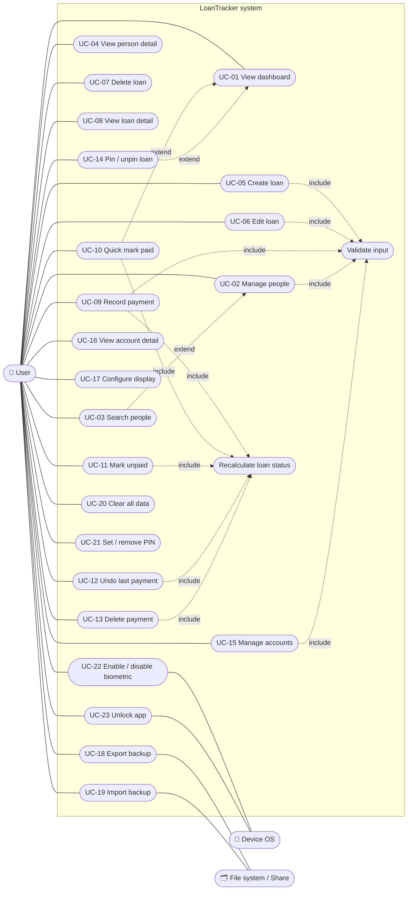
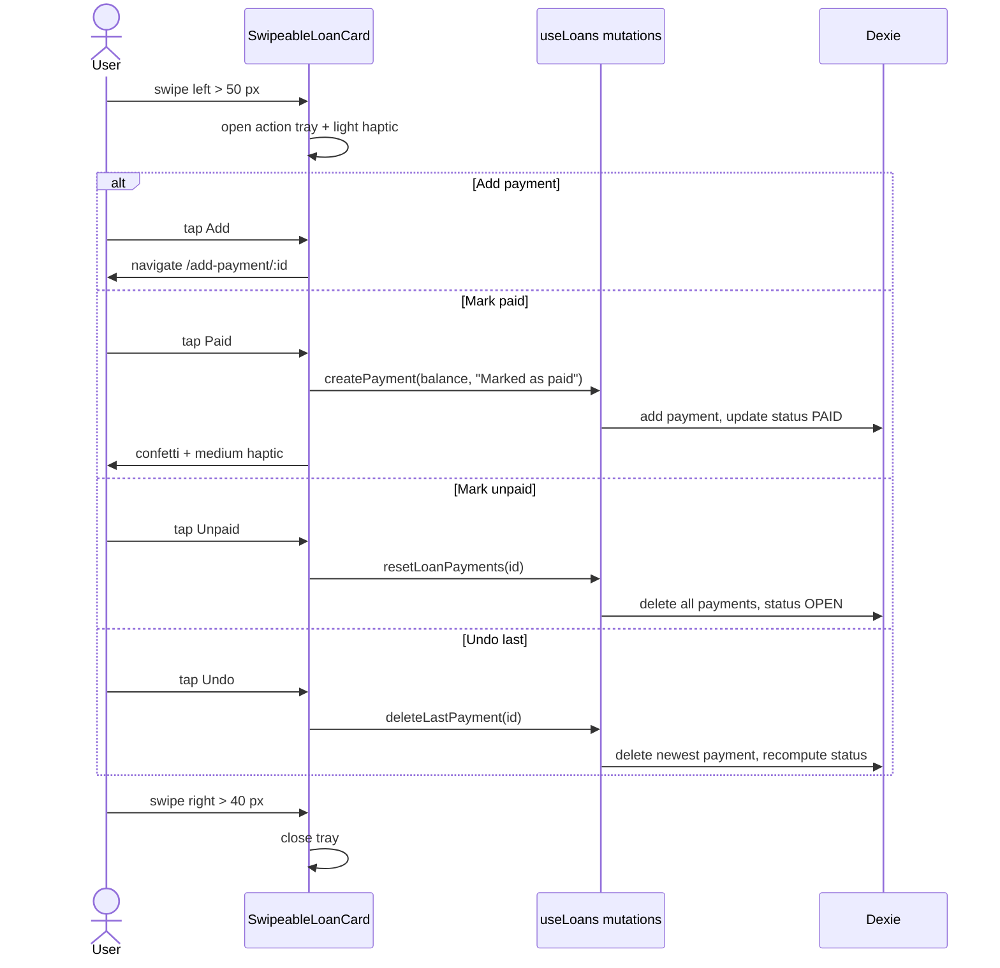

# LoanTracker — Use Cases

## 1. Actors

| Actor | Type | Description |
|---|---|---|
| **User** | Primary | The single owner of the device. Records money lent and borrowed. There are no roles or multiple users. |
| **Device OS** | Secondary | Provides biometric verification, haptics, file sharing, back button and app lifecycle events (Android via Capacitor). |
| **File system / share target** | Secondary | Receives exported backup files and supplies files for import. |

## 2. Use case diagram

Mermaid has no native UML use case diagram, so this flowchart uses the same notation: actors on the sides, use cases as rounded nodes inside the system boundary, `include` / `extend` as labelled dashed links.

## 3. Use case catalogue

| ID | Name | Screen(s) | Priority |
|---|---|---|---|
| UC-01 | View dashboard | `/` | High |
| UC-02 | Manage people (add, edit, delete) | `/people`, `/add-person`, `/edit-person/:id`, `/person/:id` | High |
| UC-03 | Search people | `/people` | Medium |
| UC-04 | View person detail | `/person/:id` | High |
| UC-05 | Create loan | `/add-loan` | High |
| UC-06 | Edit loan | `/edit-loan/:id` | Medium |
| UC-07 | Delete loan | `/loan/:id` | Medium |
| UC-08 | View loan detail | `/loan/:id` | High |
| UC-09 | Record payment | `/add-payment/:loanId` | High |
| UC-10 | Quick mark paid | Swipe on loan card | High |
| UC-11 | Mark unpaid | Swipe on loan card | Medium |
| UC-12 | Undo last payment | Swipe on loan card | Medium |
| UC-13 | Delete payment | `/loan/:id` | Medium |
| UC-14 | Pin / unpin loan | Long press on loan card | Low |
| UC-15 | Manage accounts | `/accounts`, `/add-account`, `/edit-account/:id` | Medium |
| UC-16 | View account detail | `/account/:id` | Medium |
| UC-17 | Configure display settings | `/settings` | Medium |
| UC-18 | Export backup | `/settings` | High |
| UC-19 | Import backup | `/settings` | High |
| UC-20 | Clear all data | `/settings` | Low |
| UC-21 | Set / remove PIN | `/settings` (native only) | Medium |
| UC-22 | Enable / disable biometric | `/settings` (native only) | Low |
| UC-23 | Unlock app | Lock screen (native only) | High |

## 4. Detailed use cases

### UC-01 View dashboard
- **Actor:** User
- **Precondition:** App unlocked.
- **Main flow:**
  1. User opens the app or taps **Home**.
  2. System shows a time-based greeting.
  3. System shows **To Receive** (sum of open GIVEN balances) and **To Pay** (sum of open TAKEN balances).
  4. System shows pinned, unpaid loans in their own section.
  5. System shows two tabs, **Receive** and **Pay**, listing other unpaid loans newest first with person, balance and a progress bar.
- **Alternate:** No loans → empty state with a prompt to add one.
- **Postcondition:** None (read only).

### UC-02 Manage people
- **Main flow (add):**
  1. User taps add on People (or "new person" inside Add Loan).
  2. User enters name (required), phone and notes (optional).
  3. System validates (UC-Validate) and saves with a new UUID.
  4. System shows "Person added" and returns to the previous screen.
- **Edit:** Same form, prefilled; saves and updates `updated_at`.
- **Delete:** From Person Detail, user confirms; person is removed.
- **Exception:** Name empty or > 100 chars → inline error, nothing saved.
- **Note:** Deleting a person also deletes their loans and payments.

### UC-03 Search people
1. User types in the search field on People.
2. System filters the list by case-insensitive name substring as the user types.
3. No match → "no results" empty state.

### UC-04 View person detail
1. User taps a person.
2. System shows net "to receive" and "to pay" for that person and all their loans as swipeable cards.
3. User can add a loan for this person (`/add-loan?person=<id>`), edit, or delete the person.

### UC-05 Create loan
- **Precondition:** At least one person exists (user can create one inline).
- **Main flow:**
  1. User taps the centre **+** button.
  2. User selects type: **Given** (I lent) or **Taken** (I borrowed).
  3. User selects a person, enters amount, optionally selects an account, due date and notes.
  4. System validates: person selected, amount > 0, notes ≤ 500.
  5. System saves the loan with `status = OPEN`.
  6. System shows "Loan added" and navigates back.
- **Exception:** Validation failure → inline field errors.

### UC-06 Edit loan
1. From Loan Detail, user taps edit.
2. Form opens prefilled. Person and type are fixed; **amount, account, due date and notes** can change. Status is recalculated.
3. System saves and shows "Loan updated".

### UC-07 Delete loan
1. From Loan Detail, user taps delete and confirms.
2. System deletes the loan and all its payments.
3. System navigates back and shows "Loan deleted".

### UC-08 View loan detail
1. User taps a loan card.
2. System shows person, type, amount, paid, balance, progress, due date, account, notes and payment history (date, amount, notes).

### UC-09 Record payment
- **Precondition:** Loan exists and balance > 0.
- **Main flow:**
  1. User opens Add Payment (from Loan Detail or swipe action).
  2. System shows the remaining balance; payment date defaults to today.
  3. User enters amount, date and optional notes.
  4. System validates: 0 < amount ≤ balance, date present, notes ≤ 500.
  5. System saves the payment, then recalculates status (UC-Status).
  6. System shows "Payment recorded" and navigates back.
- **Exception:** Amount > balance → error showing the remaining balance.

### UC-10 Quick mark paid
1. User swipes a loan card left and taps **Paid**.
2. System creates one payment for the full remaining balance with note "Marked as paid" and today's date.
3. Status becomes PAID; confetti animation and haptic feedback play.
4. The loan disappears from the unpaid lists.

### UC-11 Mark unpaid
1. User swipes a loan card and taps **Unpaid**.
2. System deletes **all** payments of the loan and sets status to OPEN.

### UC-12 Undo last payment
1. User swipes a loan card and taps the partial/undo action.
2. System deletes the most recent payment (by `created_at`) and recalculates status.

### UC-13 Delete payment
1. In Loan Detail payment history, user deletes a payment and confirms.
2. System deletes it and recalculates status.

### UC-14 Pin / unpin loan
1. User long-presses a loan card for 600 ms.
2. Device vibrates; loan ID is added to (or removed from) the pinned list.
3. Dashboard shows pinned loans in a separate section on top. Paid loans are hidden even if pinned.

### UC-15 Manage accounts
1. User opens Accounts and taps add, or edit on an existing account.
2. User enters name (1–50), optional description (≤ 200), and picks an icon (Wallet, Savings, Bank, Card, Cash, Business).
3. System saves and shows a toast.
4. Delete: user confirms; account is removed and its loans are unlinked.

### UC-16 View account detail
1. User taps an account.
2. System shows the total outstanding from open GIVEN loans linked to that account and lists them, largest balance first, as swipeable cards.

### UC-17 Configure display settings
1. User opens Settings → Display.
2. User selects currency (Rs., ₹, $, €, £, ¥, kr or custom), symbol position, number locale (`en-US`, `en-IN`, `de-DE`, `fr-FR`), date format, and haptic feedback on/off.
3. System saves to `localStorage` immediately and all amounts and dates re-render.

### UC-18 Export backup
1. User taps **Export**.
2. System reads all four tables and builds a JSON file `loantracker-backup-YYYY-MM-DD.json`.
3. **Android:** file written to cache, system share sheet opens; user picks a destination.
   **Browser:** file downloads.
- **Alternate:** User cancels share → no error shown.

### UC-19 Import backup
1. User taps **Import** and picks a `.json` file.
2. System asks "Replace all data?"; user confirms.
3. System parses and validates every row.
4. In one transaction, system clears all tables and bulk-adds the file's rows (`user_id` stripped).
5. System shows counts imported.
- **Exception:** Invalid JSON or format → error banner; existing data unchanged (transaction rolls back).
- **Note:** Import replaces all data; there is no merge.

### UC-20 Clear all data
1. User taps **Clear All Data** in Danger Zone.
2. System asks for confirmation.
3. On confirm, all four tables are cleared. Settings, PIN and pins in `localStorage` are kept.

### UC-21 Set / remove PIN (native only)
1. User opens Security and chooses to set a PIN.
2. User enters 4 digits (and confirms).
3. System stores the SHA-256 hash; app will lock on next start and on pause.
4. Remove PIN: deletes the hash and disables biometric.

### UC-22 Enable / disable biometric (native only)
- **Precondition:** PIN is set and device supports biometrics.
1. User toggles biometric on.
2. System shows the OS biometric prompt as a test.
3. On success the flag is saved; on failure an error is shown and the flag stays off.

### UC-23 Unlock app (native only)
- **Trigger:** App starts or returns from background with a PIN set.
- **Main flow:**
  1. Lock screen appears. If biometric is enabled, the OS prompt opens automatically.
  2. Biometric success → app unlocks.
  3. Otherwise user types the 4-digit PIN; on match, success haptic and unlock.
- **Exception:** Wrong PIN → shake + error haptic. After 3 failures, input is blocked for 30 seconds with a countdown (kept across app restarts).

## 5. Swipe-card interaction (UC-10 … UC-14)

